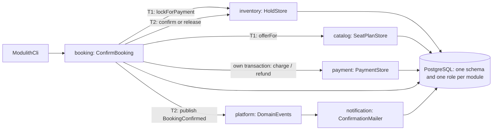

# Architecture of seatwave-modulith

## Packages and the dependency rule

Everything is under `io.plainround.seatwave.modulith`. Each business module is one top-level package with its public interface (and the value types it exchanges) at the top and an `internal` package beneath:

| Module | Interface | Internals | Schema and role |
|---|---|---|---|
| `catalog` | `Catalog` (`offerFor`, `SeatOffer`) | `SeatPlanStore` | `catalog`, `catalog_module` |
| `inventory` | `Inventory` (`hold`, `lockForPayment`, `confirm`, `release`, `Refusal`) | `HoldStore` | `inventory`, `inventory_module` |
| `payment` | `Payments` (`charge`, `refund`, `Money`, `Captured`, `Declined`) | `PaymentStore` | `payment`, `payment_module` |
| `booking` | `Bookings` (`confirm`, `resumeStuckSagas`, `ConfirmFailure`), `BookingConfirmed` | `ConfirmBooking`, `BookingSagas`, `SagaState` | `booking`, `booking_module` |
| `notification` | `Notifications.subscribeTo` | `ConfirmationMailer` | `notification`, `notification_module` |
| `platform` (shared kernel) | `Database`, `DomainEvents`, `Migrations` | none | none |

The rule: a module may use another module's interface package, never its `internal` package; the modules form no cycle; a module's code names only its own schema's tables; no foreign key crosses a schema. `ModuleBoundaryTest` checks the first three on every build, and the database checks the third again at run time with one role per module.

## Data flow of a confirm

After the extraction (`extraction/after`), `notification` is no longer in the deployable: booking's listener writes the event to `booking.outbox` in T2, a relay publishes unsent rows to the Kafka topic `seatwave.bookings`, and `notificationservice.BookingsConsumer` hands each message to `NotificationService`, which claims `confirmation/<booking_id>` in `notification.processed_messages` in the same transaction as the email.

## Walk-throughs

- **Confirm, happy path** (3 local transactions): T1 locks the hold (CONFIRMING) and writes the saga row, walking SEAT_HELD to PAYMENT_REQUESTED; payment charges in its own transaction, outside every other; T2 walks PAYMENT_SUCCEEDED to COMPLETED, confirms the hold, writes the booking and publishes `BookingConfirmed`, whose in-process listener writes the email and the reminder.
- **Declined card** (3): T2' walks PAYMENT_FAILED to COMPENSATED and releases the hold.
- **Seat taken away after payment**: T2 finds the hold no longer this booking's and commits REFUND_REQUESTED; payment refunds; a last transaction walks PAYMENT_REFUNDED to COMPENSATED.
- **A listener fails in T2**: T2 rolls back, leaving PAYMENT_REQUESTED, a CONFIRMING hold and a captured payment; the sweeper (`resumeStuckSagas`) charges again with the same provider key, which answers with the first capture, and runs T2 again.

## Decisions and trade-offs

- **One login with a role per module, not one login with every schema.** The shared transaction needs one connection, so the deployable's login takes the role of the module whose code runs (`SET ROLE`), and holds no rights itself (membership with `INHERIT FALSE`). The database then refuses a module's read of another's table even inside the shared transaction. The cost is one `SET ROLE` per module switch inside a transaction. H2 cannot switch roles, so `./gradlew check` runs with one login and only the build guards the wall there.
- **H2 for `check`, PostgreSQL for every claim about PostgreSQL.** The partial index, the grants, the empty `search_path`, savepoints and the view are tested on PostgreSQL 18.6 in the stack tests; H2 stands in for the logic and the boundary tests, so a reader without Docker can build. Both schema files are checked against the context map.
- **Every saga transition is a conditional update** from the state the worker read, so the sweeper and a late confirm can never both move one saga.
- **The extracted tree is assembled, not copied**: `assembleExtractedTree` lays `extraction/after` over `src/main` without `notification`, so the files the extraction touches are exactly the files in `extraction/after`.

## Invariants and where they are enforced

| Invariant | Enforced by |
|---|---|
| No module uses another module's internals; no cycle | `ModuleBoundaryTest` (ArchUnit), on every build |
| No module names another module's tables | `ModuleBoundaryTest` (source scan); the grants (`GrantsStackTest`) |
| Every table has one owner, its schema's module | `ModuleBoundaryTest` against `docs/context-map.txt`, both schema files |
| One live claim per seat | `one_claim_per_seat` (partial unique index on PostgreSQL, a generated claim key on H2) |
| A refused insert leaves the transaction usable | `Database.insertUnlessDuplicate` (savepoint); `PostgresRulesStackTest` |
| One booking per hold and per seat | `one_booking_per_hold`, `one_booking_per_seat` |
| Every saga ends final | the sweeper over every non-final state; `ConfirmBookingTest` per state |
| One email per booking after the extraction | the claim `one_effect_per_key`; `ExtractionStackTest` |
| No provider call inside a transaction | `PaymentStore` refuses it (`isInTransaction`) |
